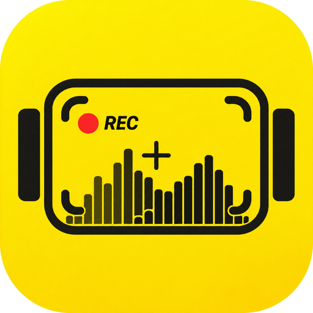

<div align="center">

<a href="https://opencapture.org/openinstacine/">
  
</a>

# OpenInstaCine

**The open field monitor for the Insta360 Luna Ultra.**<br>
Pro scopes, exposure assists, camera and gimbal control, and playback on your phone.
Free and open source.

[](https://github.com/erik-sutton95/OpenInstaCine/actions/workflows/ci.yml) [](https://opencapture.org/openinstacine/docs/) [](LICENSE) [](https://github.com/erik-sutton95/OpenInstaCine/discussions)

[](https://opencapture.org/openinstacine/) [](https://opencapture.org/openinstacine/android/)

[Website](https://opencapture.org/openinstacine/) · [Docs](https://opencapture.org/openinstacine/docs/) · [Roadmap](https://github.com/erik-sutton95/OpenInstaCine/discussions/categories/ideas) · [Report a bug](https://github.com/erik-sutton95/OpenInstaCine/issues/new?template=bug_report.yml)

</div>

<details>
<summary><strong>Table of contents</strong></summary>

- [Supported cameras](#supported-cameras)
- [Features](#features)
- [Install](#install)
- [Roadmap](#roadmap)
- [Free. Open source. Yours](#free-open-source-yours)
- [For developers](#for-developers)
  - [Built with](#built-with)
  - [Architecture](#architecture)
  - [Build from source](#build-from-source)
  - [Documentation](#documentation)
- [Contributing](#contributing)
- [Support](#support)
- [Credits](#credits)
- [License](#license)

</details>

## Supported cameras

| Camera | Live view | Camera control | Gimbal | Notes |
| --- | :---: | :---: | :---: | --- |
| **Insta360 Luna Ultra** | ✅ | ✅ | ✅ | Camera firmware 1.1.15. 720p HEVC live feed at 25 fps, I-Log and Dolby Vision, digital zoom to 15×. |

✅ works on iOS and Android.
Other Insta360 cameras are not supported.

> [!WARNING]
> Camera control is reverse-engineered and can be incomplete. Check that recording starts and
> stops on the camera body until you trust the link.

## Features

- **Read the image like a colorist.** Waveform, RGB parade, histogram and vectorscope run live
  beside the picture you are judging. Drag and resize them anywhere.
- **Catch exposure and focus before the take.** False color (CineStop scene stops, Video, IRE and
  Limits), zebras, Traffic Lights, focus peaking, an EV meter and ND suggestions.
- **See log as it will grade.** The official Insta360 I-Log to Rec.709 LUT is built in, next to
  built-in and custom `.cube` looks.
- **Match the camera's timecode.** The app sets the Luna's clock when it connects and shows the
  same time-of-day timecode as the camera.
- **Frame once for every delivery.** Grids, aspect guides and a center crosshair, in landscape
  and portrait.
- **Run the camera from the phone.** Record, ISO, shutter, white balance, EV, zoom, FORMAT,
  color mode, AF-S / AF-C / Product Showcase and METER (Matrix or Face Priority). Tap to focus
  and long-press the focus box to lock it.
- **Track your subject.** Double-tap the feed, draw a box or tap a face to start the camera's
  Deep Track.
- **Fly the gimbal.** On-screen stick or a game controller, gimbal modes and speed, Recenter,
  Double-tap Level, Motion Control moves between A, B and C, and AirPods head tracking.
- **Review before striking the set.** Browse clips and stills on the camera, star the keepers,
  delete bad takes, and play the `.lrv` proxy back with the same scopes and assists as live view.
- **Ship it with the look baked in.** Export with a built-in or custom LUT, native share, and
  optional [Frame.io](https://www.frame.io/) upload with your own Adobe app keys.

iPhone and iPad are the daily driver. Android has the monitor, assists, camera and gimbal control,
Deep Track and playback. **iOS only today:** LUT bake on export, Frame.io upload, Apple Watch,
AirPods head tracking and the flat I-Log preview. **Not on the Luna:** live audio control and
meters (the camera sets audio on its own screen), Multiview, and Wi-Fi or Hotspot setups (the
Luna only connects over its own network).

## Install

| Platform | How | Notes |
| --- | --- | --- |
| **iPhone and iPad** | TestFlight coming soon | One universal app. Until then, [build from source](#build-from-source). |
| **Android** | [Closed beta signup](https://opencapture.org/openinstacine/android/) | Android 10 or newer, arm64. |

Pairing and live view need a real camera nearby. The first connection asks you to approve the
phone on the camera's touchscreen. See the
[iOS](https://opencapture.org/openinstacine/docs/apps/ios/) and
[Android](https://opencapture.org/openinstacine/docs/apps/android/) guides and the
[latest release notes](https://opencapture.org/openinstacine/docs/releases/0-1-0/).

## Roadmap

The roadmap lives in [GitHub Discussions](https://github.com/erik-sutton95/OpenInstaCine/discussions).
Browse the [Ideas category](https://github.com/erik-sutton95/OpenInstaCine/discussions/categories/ideas)
to vote, add production context, or propose what to tackle next. Roadmap threads describe
direction, not promised dates. What works, what is Luna-specific and what is still missing is
tracked feature by feature in [`docs/implementation/luna-ios-status.md`](docs/implementation/luna-ios-status.md).

## Free. Open source. Yours

No subscriptions, no paywalls, no advertising, and no tracking. Crash reports are opt-in.
OpenInstaCine is Apache-2.0 licensed and is a sister app of
[OpenPocketCine](https://opencapture.org/openpocketcine/): the same monitor, screens and UX with a
yellow accent and a Luna backend in place of the DJI link. It is built in public with the latest
frontier models, so filmmakers and developers can inspect, improve and adapt the tool they rely on.

## For developers

### Built with

[](https://www.swift.org/) [](https://developer.apple.com/xcode/swiftui/) [](https://developer.apple.com/metal/) [](https://developer.apple.com/documentation/corebluetooth) [](https://kotlinlang.org/) [](https://developer.android.com/compose) [](https://www.vulkan.org/) [-362D59?style=flat-square&logo=sentry&logoColor=white)](https://sentry.io/) [](https://starlight.astro.build/)

The iOS project is generated with [XcodeGen](https://github.com/yonaskolb/XcodeGen). The shared
Swift core runs on Android through JNI. The Luna link is protobuf messages in UCD2 frames over
Bluetooth LE and TCP, with a hand-written codec (no Insta360 SDK).

### Architecture

A shared Swift business core from OpenPocketCine, Luna protocol adapters and native platform shells:

| Layer | Path | Purpose |
| --- | --- | --- |
| **Shared core** | `Sources/` | OpenPocketCine monitor core (`OpenPocketViewCore`, ...) with small Luna hooks |
| **Shared UI** | `../OpenCineUI` | Sibling checkout of OpenCineUI: SwiftUI `MonitorUI` and `MonitorPresentation`, Compose `monitor-ui` |
| **Shared camera core** | `../OpenCineCore` | Sibling checkout of OpenCineCore: camera `CameraSession` contracts (Swift and Kotlin `:core`) and `OpenCineMedia` (LUT, curve, scope math) |
| **Luna integration** | `../OpenCineInsta360` | Sibling checkout of OpenCineInsta360: `Insta360Protocol` (UCD2 framing, protobuf, status, settings, media and control messages) and `Insta360Apple` (CoreBluetooth pairing, CryptoKit handshake, Keychain, camera Wi-Fi join, TCP transport, the Luna `CameraSession`) |
| **iOS app** | `ios/OpenInstaCine/` | The OpenPocketCine shell plus the Luna session (`CameraSession*.swift`, `LunaShellMapping.swift`); Apple Watch app in `ios/OpenInstaCineWatch/` |
| **Android app** | `Apps/Android/` | Jetpack Compose shell (`app`, `monitor`) on OpenCineUI `monitor-ui`, and the Kotlin Luna adapter from OpenCineInsta360 (`insta360-luna`) |
| **Android facade** | `Sources/OpenPocketCineAndroidFacade/` | Swift session and JNI boundary for Android |
| **Tests** | `Tests/`, `ios/OpenInstaCineTests/` (protocol and Luna session tests live in OpenCineInsta360) | Core and app tests |

`OpenPocketViewCore` and the Luna protocol codec stay portable (Foundation only, no SwiftUI,
UIKit or Android dependencies). Platform shells own sockets, permissions, lifecycle, rendering and
UI. The shell is
re-synced from OpenPocketCine with `just sync-openpocketcine`, which leaves the Luna files alone.
The contract between the two apps is [`docs/SHARED-MONITOR-ENGINE.md`](docs/SHARED-MONITOR-ENGINE.md).

### Build from source

Tooling runs through [`just`](https://github.com/casey/just) and needs Xcode 26 and XcodeGen.
Both apps also need the shared packages OpenCineUI and OpenCineCore checked out next to this
repository, at `../OpenCineUI` and `../OpenCineCore`, and the iOS app needs OpenCineInsta360 at
`../OpenCineInsta360`; `Package.swift`, `ios/project.yml` and
`Apps/Android/settings.gradle.kts` reference them by path.
`scripts/checkout-opencine.sh` clones them there at the commits pinned in `opencine-pins.txt`
(CI and Xcode Cloud use the same script); an existing checkout is only compared, never moved.


```bash
just                      # list all recipes
just ios-generate         # generate the Xcode project
just ios-build            # Simulator build, no signing
just ios-run [device]     # signed build, install and launch on a USB iPhone
just ios-test             # app unit tests
just core-test            # shared core and Luna protocol tests
just android-check        # build, test, and lint Android
just sync-openpocketcine  # re-sync the shell from ../OpenPocketCine
```

The handbook runs locally from `handbook/` with `npm ci && npm run dev`
(see [`handbook/README.md`](handbook/README.md)).

> [!TIP]
> The Simulator has no Bluetooth or hotspot API. It can still reach a camera when the Mac joins
> the camera's Wi-Fi; see the Simulator rig in [`docs/DEVELOPMENT.md`](docs/DEVELOPMENT.md).
> Pairing from the app needs a physical iPhone or Android phone and a camera.

Releases: TestFlight archives come from Xcode Cloud ([`docs/testflight-ci.md`](docs/testflight-ci.md)).
Play closed testing is in [`docs/android-play-ci.md`](docs/android-play-ci.md).

### Documentation

- **[Docs](https://opencapture.org/openinstacine/docs/)**: protocol, iOS and Android apps, and how to build.
  Keep them current in the same PR ([standard](https://opencapture.org/openinstacine/docs/contribute/documentation/)).
- [`docs/DEVELOPMENT.md`](docs/DEVELOPMENT.md): layout, Simulator rig, DEBUG remote, Mac live-view lab
- [`docs/implementation/luna-ios-status.md`](docs/implementation/luna-ios-status.md): feature status and parity with OpenPocketCine
- [`docs/SHARED-MONITOR-ENGINE.md`](docs/SHARED-MONITOR-ENGINE.md): shared engine contract with OpenPocketCine
- [`docs/RELEASE.md`](docs/RELEASE.md): TestFlight and Play release process
- [`docs/research/luna-fw-1.1.15-verification.md`](docs/research/luna-fw-1.1.15-verification.md): hardware verification on firmware 1.1.15
- [`docs/research/luna-command-catalog.md`](docs/research/luna-command-catalog.md): command catalog

Raw captures, camera footage, identities and Wi-Fi credentials stay in the gitignored `captures/`
and `.local/` folders. The app keeps its approval identity and camera Wi-Fi password in the
Keychain.

## Contributing

Contributions are welcome.

- Read [`docs/DEVELOPMENT.md`](docs/DEVELOPMENT.md) for the layout, build recipes and the
  Simulator rig.
- Bugs go in [GitHub's bug-report form](https://github.com/erik-sutton95/OpenInstaCine/issues/new?template=bug_report.yml).
  Never put camera Wi-Fi passwords, approval identities or captures in an issue.
- Ideas and questions go in **GitHub Discussions**:
  [Ideas](https://github.com/erik-sutton95/OpenInstaCine/discussions/categories/ideas) and
  [Q&A](https://github.com/erik-sutton95/OpenInstaCine/discussions/categories/q-a).
- Please read the [`CODE_OF_CONDUCT.md`](CODE_OF_CONDUCT.md).

<a href="https://github.com/erik-sutton95/OpenInstaCine/graphs/contributors">
  
</a>

## Support

I truly appreciate everyone who uses this project, files an issue, or sends a patch. Optional
[Buy Me a Coffee](https://buymeacoffee.com/eriksutton) contributions help keep the lights on. If
you would rather give to a charity, especially one that helps animals, that is just as welcome.

## Credits

The Luna Bluetooth bootstrap was learned with the help of
[luna-ai-cut](https://github.com/diamondfsd/luna-ai-cut) by diamondfsd (MIT), and hardware notes
from [insta360-luna-ultra-desktop](https://github.com/Ripwords/insta360-luna-ultra-desktop) by
Ripwords. The community protobuf schema in
[insta360-nas](https://github.com/iliakonnov/insta360-nas) by iliakonnov was a reference for
message and command names. I'm grateful to all three. The rest of the protocol was mapped from our
own Bluetooth and Wi-Fi captures. The monitor itself comes from
[OpenPocketCine](https://opencapture.org/openpocketcine/).

## License

[Apache 2.0](LICENSE). See [NOTICE](NOTICE); third-party licenses are listed in
[`THIRD-PARTY-NOTICES.md`](THIRD-PARTY-NOTICES.md). The app's privacy policy lives at
[opencapture.org/openinstacine/privacy](https://opencapture.org/openinstacine/privacy/).

This project is not affiliated with, endorsed by, or supported by Insta360 (Arashi Vision Inc.).
No Insta360 SDK or proprietary documentation is included in, distributed with, or required by
this project. "Insta360" and "Luna" are trademarks of Arashi Vision Inc., used here for
identification only.
