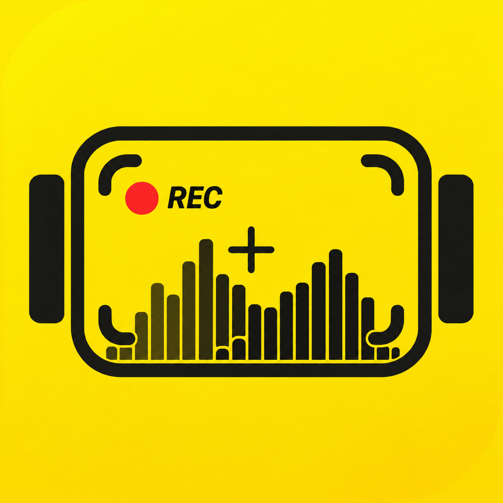

<div align="center">



# OpenInstaCine

**The open field monitor for the Insta360 Luna Ultra.**<br>
Pro scopes, exposure assists, camera and gimbal control, and playback on your phone.
Free and open source.

[](LICENSE) [](docs/research/luna-fw-1.1.15-verification.md) [](https://openpocketcine.app/)

[Feature status](docs/implementation/luna-ios-status.md) · [Develop](docs/DEVELOPMENT.md) · [Report a bug](https://github.com/erik-sutton95/OpenInstaCine/issues/new)

</div>

<details>
<summary><strong>Table of contents</strong></summary>

- [Supported cameras](#supported-cameras)
- [Features](#features)
- [Install](#install)
- [Roadmap](#roadmap)
- [Free. Open source. Yours](#free-open-source-yours)
- [For developers](#for-developers)
  - [Built with](#built-with)
  - [Architecture](#architecture)
  - [Build from source](#build-from-source)
  - [Documentation](#documentation)
- [Contributing](#contributing)
- [Support](#support)
- [Credits](#credits)
- [License](#license)

</details>

## Supported cameras

| Camera | Live view | Camera control | Gimbal | Notes |
| --- | :---: | :---: | :---: | --- |
| **Insta360 Luna Ultra** | ✅ | ✅ | ✅ | Firmware 1.1.15. 720p HEVC live feed at 25 fps, I-Log and Dolby Vision, digital zoom to 15×. |

✅ works on iOS. The Android app is synced with the iOS app and builds, but is not yet verified on a physical Luna.

> [!WARNING]
> Camera control is reverse-engineered and can be incomplete. Check that recording starts and
> stops on the camera body until you trust the link.

## Features

- **Read the image like a colorist.** Waveform, RGB parade, histogram and vectorscope run live
  beside the picture you are judging. Drag and resize them anywhere.
- **Catch exposure and focus before the take.** False color (CineStop and IRE), zebras,
  Traffic Lights, focus peaking, an EV meter and ND suggestions.
- **See log as it will grade.** The official Insta360 I-Log to Rec.709 LUT is built in, next to
  built-in and custom `.cube` looks.
- **Match the camera's timecode.** The app sets the Luna's clock when it connects and shows the
  same time-of-day timecode as the camera.
- **Frame once for every delivery.** Grids, aspect guides and a center crosshair, in landscape
  and portrait.
- **Run the camera from the phone.** Record, ISO, shutter, white balance, EV, zoom, FORMAT,
  color mode, AF-S / AF-C / Product Showcase and face metering. Draw a box or tap a face to
  start Deep Track.
- **Fly the gimbal.** On-screen stick or a game controller, gimbal modes and speed, Double-tap
  Level, Motion Control moves between A, B and C, and AirPods head tracking.
- **Review before striking the set.** Browse clips and stills on the camera, star the keepers,
  delete bad takes, and play the `.lrv` proxy back with the same scopes and assists as live view.

iPhone and iPad are the daily driver. Not on the Luna yet: live audio control and
meters (the camera sets audio on its own screen), Multiview, and Wi-Fi or Hotspot setups (the
Luna only connects over its own network).

## Install

| Platform | How | Notes |
| --- | --- | --- |
| **iPhone and iPad** | [Build from source](#build-from-source) | One universal app. TestFlight setup: [`docs/RELEASE.md`](docs/RELEASE.md). |
| **Android** | [Build from source](#build-from-source) | Synced with the iOS app and builds. Not yet verified on a physical Luna. |

Pairing and live view need a real camera nearby. The first connection asks you to approve the
phone on the camera's touchscreen.

## Roadmap

What works, what is Luna-specific and what is still missing is tracked feature by feature in
[`docs/implementation/luna-ios-status.md`](docs/implementation/luna-ios-status.md). Next up:
verifying Android on a real Luna, showing a clip's audio mode, and Color Recovery for the detachable screen.

## Free. Open source. Yours

No subscriptions, no paywalls, no advertising, and no tracking. OpenInstaCine is Apache-2.0
licensed and is a sister app of [OpenPocketCine](https://openpocketcine.app/): the same monitor,
screens and UX with a yellow accent and a Luna backend in place of the DJI link. It is built with
the latest frontier models, so filmmakers and developers can inspect, improve and adapt the tool
they rely on.

## For developers

### Built with

[](https://www.swift.org/) [](https://developer.apple.com/xcode/swiftui/) [](https://developer.apple.com/metal/) [](https://developer.apple.com/documentation/corebluetooth)

### Architecture

The shared OpenPocketCine core and iOS shell, with a Luna backend:

| Layer | Path | Purpose |
| --- | --- | --- |
| **Shared core** | `Sources/` | OpenPocketCine monitor core (`OpenPocketViewCore`, `MonitorContracts`, `MonitorUI`, ...) with small Luna hooks |
| **Luna protocol** | `Adapters/Insta360Protocol/` | Portable codec: UCD2 framing, protobuf, status, settings, media and control messages |
| **Luna Apple adapter** | `Adapters/Insta360Apple/` | CoreBluetooth pairing, CryptoKit handshake, Keychain, camera Wi-Fi join, TCP transport |
| **iOS app** | `ios/OpenInstaCine/` | The OpenPocketCine shell plus the Luna session (`CameraSession*.swift`, `LunaShellMapping.swift`) |
| **Tests** | `Tests/`, `Adapters/Insta360Protocol/Tests/`, `ios/OpenInstaCineTests/` | Core, protocol and app tests |

The shell is re-synced from OpenPocketCine with `just sync-openpocketcine`, which leaves the Luna
files alone. The contract between the two apps is
[`docs/SHARED-MONITOR-ENGINE.md`](docs/SHARED-MONITOR-ENGINE.md).

### Build from source

Tooling runs through [`just`](https://github.com/casey/just) and needs Xcode 26 and XcodeGen:

```bash
just                      # list all recipes
just ios-generate         # generate the Xcode project
just ios-build            # Simulator build, no signing
just ios-run [device]     # signed build, install and launch on a USB iPhone
just ios-test             # app unit tests
just core-test            # shared core and Luna protocol tests
just sync-openpocketcine  # re-sync the shell from ../OpenPocketCine
```

> [!TIP]
> The Simulator has no Bluetooth or hotspot API. It can still reach a camera when the Mac joins
> the camera's Wi-Fi; see the Simulator rig in [`docs/DEVELOPMENT.md`](docs/DEVELOPMENT.md).

### Documentation

- [`docs/DEVELOPMENT.md`](docs/DEVELOPMENT.md): layout, Simulator rig, DEBUG remote, Mac live-view lab
- [`docs/implementation/luna-ios-status.md`](docs/implementation/luna-ios-status.md): feature status and parity with OpenPocketCine
- [`docs/SHARED-MONITOR-ENGINE.md`](docs/SHARED-MONITOR-ENGINE.md): shared engine contract with OpenPocketCine
- [`docs/research/luna-fw-1.1.15-verification.md`](docs/research/luna-fw-1.1.15-verification.md): hardware verification on firmware 1.1.15
- [`docs/research/luna-command-catalog.md`](docs/research/luna-command-catalog.md): command catalog
- [`docs/research/luna-head-tracker-and-gimbal-angle.md`](docs/research/luna-head-tracker-and-gimbal-angle.md): absolute gimbal angle and head tracking

Raw captures, camera footage, identities and Wi-Fi credentials stay in the gitignored `captures/`
and `.local/` folders. The app keeps its approval identity and camera Wi-Fi password in the
Keychain.

## Contributing

Contributions are welcome. Bugs go in
[GitHub issues](https://github.com/erik-sutton95/OpenInstaCine/issues/new). Never put camera Wi-Fi
passwords, approval identities or captures in an issue.

## Support

I truly appreciate everyone who uses this project, files an issue, or sends a patch. Optional
[Buy Me a Coffee](https://buymeacoffee.com/eriksutton) contributions help keep the lights on. If
you would rather give to a charity, especially one that helps animals, that is just as welcome.

## Credits

The Luna Bluetooth bootstrap was learned with the help of
[luna-ai-cut](https://github.com/diamondfsd/luna-ai-cut) by diamondfsd (MIT), and hardware notes
from [insta360-luna-ultra-desktop](https://github.com/Ripwords/insta360-luna-ultra-desktop) by
Ripwords. I'm grateful to both. The rest of the protocol was mapped from our own Bluetooth and
Wi-Fi captures. The monitor itself comes from [OpenPocketCine](https://openpocketcine.app/).

## License

[Apache 2.0](LICENSE). See [NOTICE](NOTICE); third-party licenses are listed in
[`THIRD-PARTY-NOTICES.md`](THIRD-PARTY-NOTICES.md).

This project is not affiliated with, endorsed by, or supported by Insta360 (Arashi Vision Inc.).
No Insta360 SDK or proprietary documentation is included in, distributed with, or required by
this project. "Insta360" and "Luna" are trademarks of Arashi Vision Inc., used here for
identification only.
