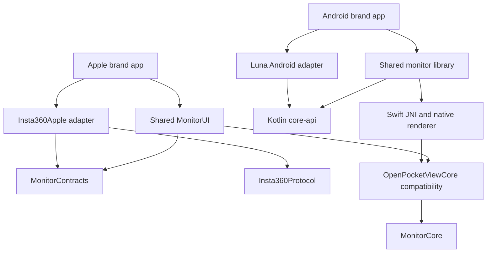

# Implemented architecture and migration boundary

Date: 2026-09-11. This describes the source currently in OpenInstaCine. The
[shared-engine standard](../SHARED-MONITOR-ENGINE.md) is the long-term contract;
the older [integration inventory](../shared-engine-integration.md) and platform
inventories describe the baseline and planning inputs, not completed sibling
migrations.

The shell was extracted from OpenPocketCine commit
`9c4e7334ca4d935c5d467abecaf8f968f7927d84`, preserving the existing native screen
and renderer implementations. [Baseline provenance](baseline-provenance.json)
records original paths and source hashes. OpenPocketCine and OpenZCine were
read as references and were not modified by this extraction.

## Ownership and dependencies

| Owner / location | Responsibility and current dependencies |
| --- | --- |
| `Apps/Apple/OpenInstaCine` | App identity, yellow palette, assets, entitlements, configuration and backend construction. Instantiates `MonitorAppRoot` with `LunaCameraBackend` |
| `Shared/Apple/MonitorUI` | SwiftUI screens, shared presentation `CameraSession`, VideoToolbox/Metal processing, scopes/assists, settings, local cache/player, delivery and diagnostics. Depends on `MonitorContracts` and the `OpenPocketViewCore` compatibility product |
| `Sources/MonitorContracts` | Foundation-only Apple backend seam: capabilities, discovery, phases, information/status, encoded frames, semantic control intents, media descriptors and network handoff |
| `Sources/MonitorCore` | Foundation-only shared math/policies: transfer/scopes, cube processing, layout, presentation gates, standardized NAL helpers, cache/conform and recovery policies. No wire codec or OS I/O |
| `Adapters/OsmoCompatibility` | Legacy `OpenPocketViewCore` module. Reexports `MonitorCore` and retains Osmo models, DUML codecs/control values and mixed compatibility helpers |
| `Adapters/Insta360Protocol` | Independent Swift package for UCD2, bounded reassembly/checksum, protobuf, scheme-3 envelopes and verified Luna read/live commands. Foundation only, no network/BLE/crypto implementation |
| `Adapters/Insta360Apple` | CoreBluetooth, CryptoKit, Keychain, hotspot join, Network.framework TCP and Luna session lifetime. Depends only on `MonitorContracts` and `Insta360Protocol` |
| `Apps/Android/app` | Thin branded activity, app manifest and DEBUG replay selection. Installs the brand identity and Luna backend factory |
| `Apps/Android/monitor` | Shared Compose shell, MediaCodec, Vulkan/GLES, assists, library/player, local delivery and Android integration. Depends on `:core-api` and staged native libraries |
| `Apps/Android/core-api` | Kotlin/JVM backend discovery/lifecycle/state/capability/frame contract. Uses coroutines/flows; no Compose or Android platform types |
| `Apps/Android/luna-adapter` | Android GATT, JCA cryptography, Wi-Fi/network-bound socket lifecycle and a Kotlin UCD2 implementation; depends on `:core-api` |
| `Sources/OpenPocketCineAndroidFacade`, `Sources/CJNI` | Existing Swift JNI exports and Android header shim. Dynamic product `OpenPocketCineAndroid` still imports the compatibility module, which supplies the single extracted `MonitorCore` implementation |

The Apple and Android backend contracts express the same live-connection seam,
but are not one generated cross-language API. Apple already includes optional
semantic control/media operations. Android's new neutral contract currently
covers the live path; its inherited control/media view models remain staged
compatibility code. Kotlin Luna framing is a separately tested implementation,
not a call through the Swift Luna package. Adding controls/media should extend
the neutral contract before implementing camera commands.

## Luna feed path

1. Discover BE80, subscribe to BE82 and issue BE81 writes with acknowledgment.
2. Check the model and negotiate scheme 3 using ephemeral P-256 ECDH,
   HKDF-SHA256 and AES-128-GCM. Use an installation-owned authorization UUID.
3. Check authorization. If required, request approval and wait for the camera's
   touchscreen result. Read the encrypted Wi-Fi response only after approval.
4. Associate with the camera AP and open TCP `192.168.42.1:6666` on its network.
   The Apple adapter compares BLE/TCP serials to detect a different camera at
   the same private address.
5. Send the observed prefix, wait for the camera greeting, start two-second
   heartbeats, read model/auth/status and issue the verified live-start command.
6. Validate frame length/checksum, interpret media subtype `0x20`, remove its
   eight-byte little-endian timing prefix, and deliver Annex-B HEVC to the
   shared native decoder. Scope/assist work uses real decoded pixels.
7. Disconnect with a best-effort live stop, cancel outstanding work and discard
   transport/key state. Recovery is bounded and returns to operator action
   rather than running an endless retry loop.

The observed packet counter advances by 40 at a 25 fps preview cadence. Its
absolute epoch is not established, and it must not be presented as camera
timecode. Preview dimensions, frame rate and Rec.709 transfer do not establish
capture mode, recording rate, recording color profile or media metadata.

The Apple adapter correlates requests by transport generation plus unique
operation ID. A request completes only after both a valid response and the
write completion, covering notification-before-ATT-ack ordering. Approval is
scoped to its active request. Decode generation is checked before assist work
and presentation. The [review](apple-adapter-review.md) explains these fixes and
the remaining deterministic race-test coverage.

## Shared shell behavior retained

The source retains the baseline native monitor rather than constructing a
second set of similar screens. This includes both orientation layouts, the
status/assist/control rails, DISP modes and editor, lock, saved-camera/setup
flow, settings and recovery chrome. Image tools include LUT, peaking, false
color, zebras, waveform, parade, histogram, vectorscope, traffic lights, guides,
grid, crosshair and mirror. Audio UI and gimbal/head-tracking input components
remain reusable but cannot control or measure unsupported Luna features.

The media library/player/cache and delivery surfaces remain shared. Apple's
facade maps optional backend media descriptors to the inherited presentation
model and protects work across camera switches. Luna advertises no camera-media
capability, so this does not claim a working Luna catalog/download/delete path.
Local footage review and explicit replay can exercise the shared player. Apple
retains its Frame.io delivery and LUT bake implementations; configuration is
absent by default. Android retains its existing system-share/delivery scope;
Apple-only baseline features were not invented as Android parity claims.

The palette changes app accents to `#FFCF00` while retaining charcoal neutrals,
fonts, Lucide icons and semantic image-analysis colors. The exact surface
inventory is preserved in [iOS parity](ios-parity-inventory.md) and
[Android parity](android-parity-inventory.md). Retaining source does not by
itself certify every interaction on every device; test and visual review
evidence must be reported separately.

## What remains staged

1. **Sibling adoption:** OpenPocketCine/OpenZCine still use their original
   implementations. A later change must pin this shared engine, build their
   Osmo/Nikon adapters and replace their screen ownership. No Nikon adapter or
   sibling target migration is claimed here.
2. **Compatibility models:** `MonitorLUT`, `MediaFile`, status/control enums,
   saved-camera records and several rendering bridges still use inherited
   names/types. Native view facades translate where needed. Osmo wire bytes
   are isolated from the new Luna adapter; type-name cleanup is incomplete.
3. **Portable versus platform:** Foundation math is extracted. VideoToolbox,
   Metal, CoreVideo, Android renderers, native media storage and delivery
   services remain platform implementations. The complete delivery queue has
   not been moved into Foundation-only code.
4. **JNI compatibility:** The old `com.opencapture.openpocketcine` internal
   package, JNI symbols and `OpenPocketCineAndroid` library name remain so the
   inherited decoder/LUT/assist calls load correctly. The installed brand app
   ID is `com.opencapture.openinstacine`. Rename both sides together later.
5. **Profiles/assets:** Some inherited color/profile catalog machinery and DJI
   LUT resources remain compatibility material. Luna uses authoritative
   Rec.709 metadata, without the old scene-brightness D-Log inference. Future
   source-profile catalogs belong behind normalized profile capabilities.
6. **Camera commands:** Every capability beyond live video requires research,
   strict codec tests, a native adapter mapping and real-camera validation
   before enabling its shared UI operation.

The shared-core [extraction report](shared-core-extraction.md) lists precise
file-level debts. Boundary tests prevent DUML/UCD2 wire APIs from being added
back to `MonitorCore`, `MonitorContracts` or shared Apple screens. The current
Gradle module split and inherited dependency metadata workaround remain
visible in build files rather than hidden in generated binaries.

## Validation boundaries and repeatable commands

| Evidence | What it establishes |
| --- | --- |
| Python Mac live viewer, [measured report](../mac-preview.md) | Real own-client BLE/auth/Wi-Fi/TCP live preview on Luna firmware v1.0.288, including acknowledged stop and reconnect |
| `swift test` | Shared portable behavior, compatibility/JNI facade helpers and module-boundary checks; 609 passed at extraction |
| `swift test --package-path Adapters/Insta360Protocol` | 24 sanitized fixture, malformed frame, fragmentation, checksum and protobuf/envelope tests |
| Android JVM tests/build/lint | 462 inherited monitor tests and 9 Luna tests reported passing; arm64 APK/native staging and lint. Does not exercise physical Android radio/network permissions |
| Apple UI suite and native builds | 413 UI tests completed, one optional fixture skip, no failures. Simulator Debug, unsigned iOS Release and Catalyst Debug builds succeeded; private replay review does not prove native camera association |
| Apple Simulator / Android emulator LOCAL REPLAY | Decoding, real-image scopes, presentation and shared UI from private recorded footage. Does not connect to a camera |
| Native physical-device run | Still required for first-install Bluetooth/Local Network/Wi-Fi consent, feed startup and sustained reconnect. No phone actions were performed during this implementation review |

See the root [README](../../README.md#build-and-review) for commands. Apple uses
`xcodegen --spec Apps/Apple/project.yml`, `just apple-build`, and UUID-explicit
`just apple-test`, `just apple-simulator` and `just apple-replay`. Android uses
`Apps/Android/gradlew -p Apps/Android` with `:app:assembleDebug`,
`:monitor:testDebugUnitTest`, `:luna-adapter:testDebugUnitTest` and each module's
`lintDebug`. The final [acceptance report](acceptance.md) records verification
after subsequent integration changes. The completed Apple test run is logged
privately in `.local/apple-ui-tests-final.log`.

Apple replay is selected explicitly through the DEBUG `OPENINSTA_REVIEW_INDEX`
entrypoint; Android uses a DEBUG-only `local_replay` launch flag. Private
recordings/indexes are neither committed nor shipped. Both display LOCAL
REPLAY, and neither should be cited as hardware streaming. All build/launch
review helpers select simulators explicitly, leaving the connected phone alone.

The separate real-camera Python lab remains available for authorized hardware
work. Captures, HCI/BLE logs, SSIDs/passwords, client identifiers and raw camera
images remain private. Apple saves its approval identity and Wi-Fi credentials
in Keychain. Android saves its own installation identity and holds session
keys/Wi-Fi passwords only in memory. Frame.io configuration is supplied locally
or by CI. Platform-specific implementation and review details are in
[Apple session](apple-session.md) and [Android shell](android-shell.md).
